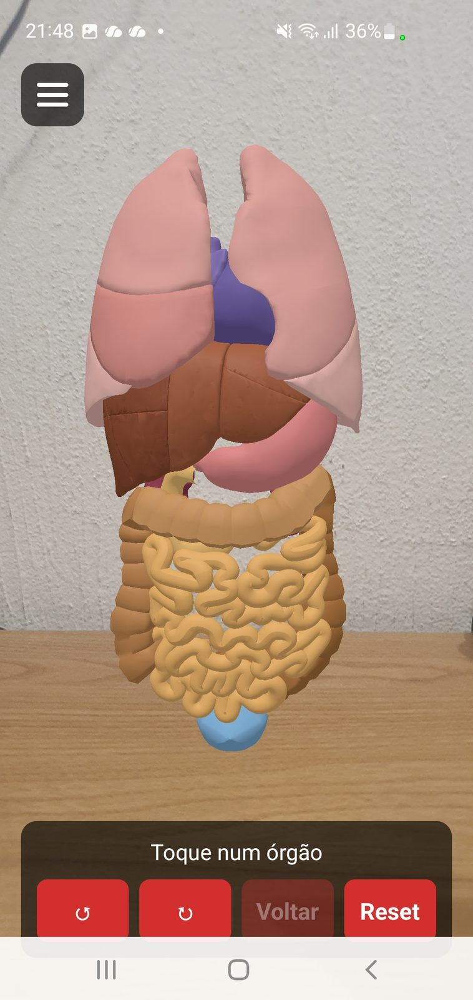
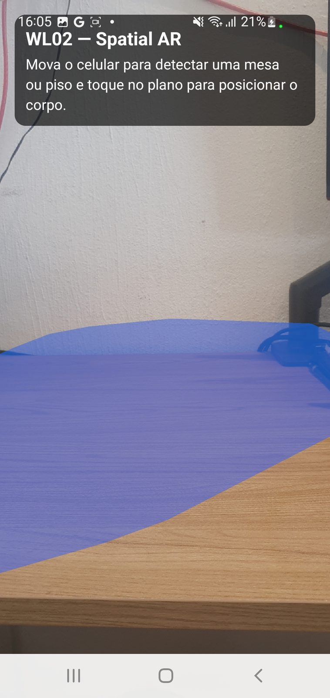
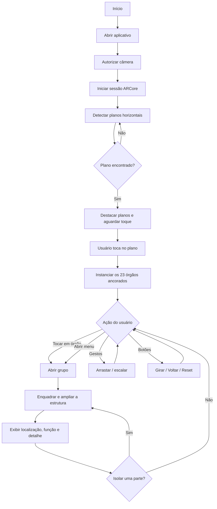
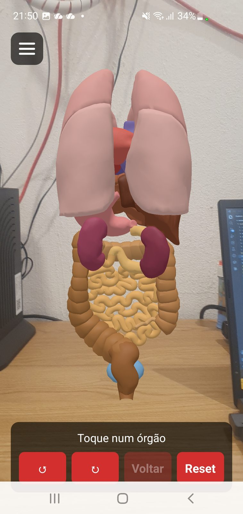
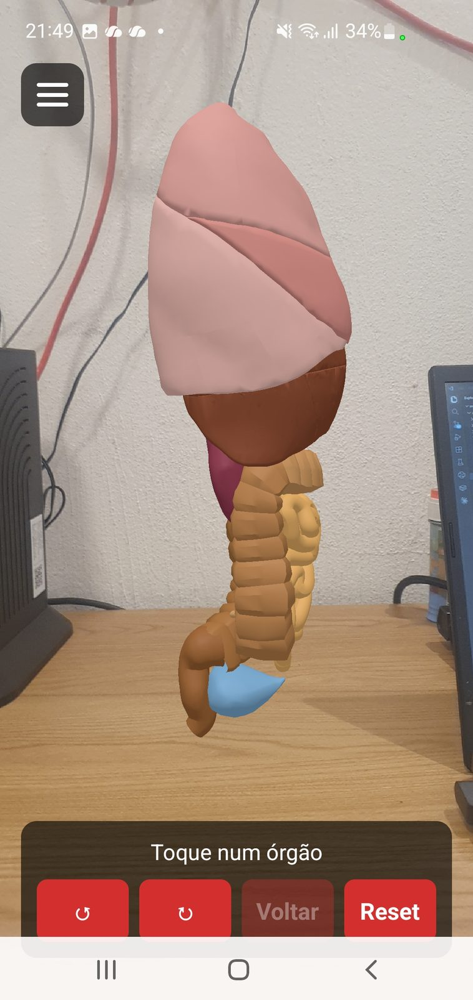
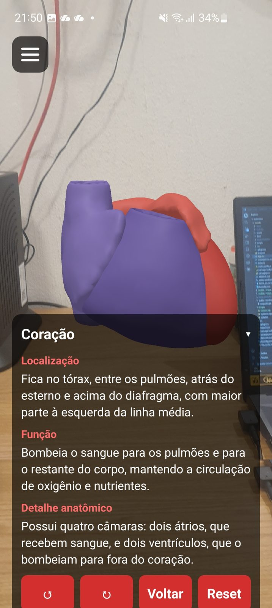
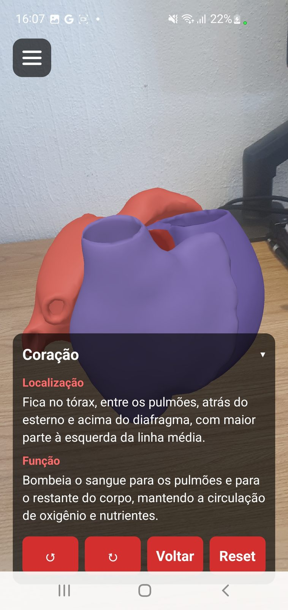
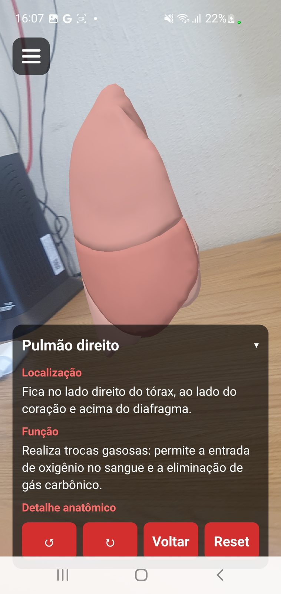
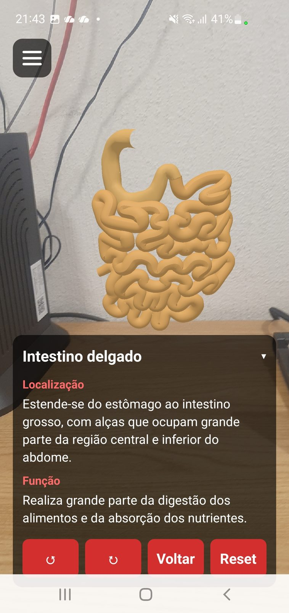
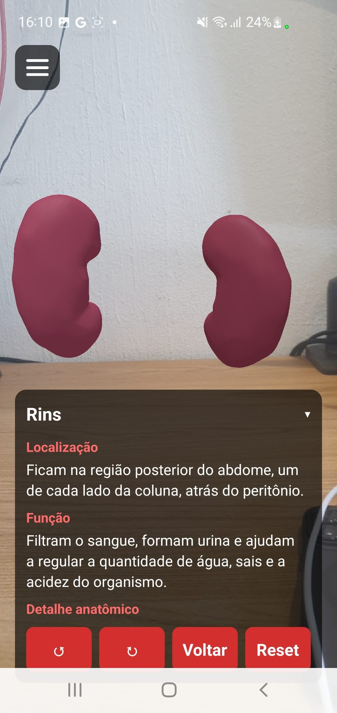

# MetaVision — Anatomia em Realidade Aumentada

> **Projeto UPX — Realidade Aumentada · Facens · 2026.2**
> Aplicativo Android de Realidade Aumentada que posiciona um modelo anatômico 3D sobre uma superfície real e permite explorar 23 órgãos interativos, com descrição individual de cada estrutura.


---

## 1. Identificação do Projeto

| Item | Informação |
|---|---|
| **Projeto** | MetaVision — Anatomia em Realidade Aumentada |
| **Equipe** | MetaVision |
| **Curso** | Engenharia de Computação |
| **Disciplina** | UPX — Realidade Aumentada |
| **Professor** | Daniel Ohata |
| **Instituição** | Centro Universitário Facens — Sorocaba/SP |
| **Semestre** | 2026.2 |

### Integrantes

| Nome | RA | Responsabilidade |
|---|---|---|
| Carolina Leamari | 235249 | Aquisição e preparação dos assets 3D (Blender, Z-Anatomy/NIH 3D, exportação GLB) |
| Eduarda Gomes Abreu e Almeida | 236021 | Interação — seleção de órgãos, isolamento e navegação |
| Fernanda Theodoro Casali | 235329 | Documentação técnica, pesquisa e artigo científico |
| Gabriel Baldi Gomes dos Santos | 235452 | Interação por toque e validação da renderização em RA |
| Gabriel Massayuki Teixeira Ogino | 236044 | Interação — enquadramento e transições |
| Higor Bertinotti Aranda | 235332 | Desenvolvimento 3D e visualização |
| Lucas Proença Gonçalves do Santos | 235411 | Desenvolvimento 3D, pipeline de modelos e integração ViroReact |

---

## 2. Visão Geral

O **MetaVision** é um aplicativo Android de Realidade Aumentada voltado ao ensino de anatomia. Usando a câmera do celular, o aplicativo detecta uma superfície horizontal real — uma mesa, uma bancada ou o piso — e posiciona sobre ela um modelo anatômico tridimensional em escala. O estudante pode então caminhar ao redor do modelo, girá-lo, aproximá-lo e **tocar diretamente em cada órgão** para isolá-lo e ler sua descrição.

O problema que motiva o projeto é a dificuldade que estudantes da área da saúde têm em compreender a **disposição espacial** dos órgãos quando o estudo depende apenas de imagens bidimensionais de livros e atlas impressos. A imagem estática não transmite profundidade, não permite mudar o ponto de vista e não deixa o estudante separar uma estrutura do conjunto para examiná-la.

A Realidade Aumentada participa da solução como o meio pelo qual o modelo deixa de ser uma figura na tela e passa a ocupar o espaço físico da sala. O ARCore reconhece o ambiente e fornece o rastreamento, de modo que o modelo permanece ancorado no mesmo ponto da mesa enquanto o estudante se movimenta — é essa estabilidade espacial que permite observar as relações entre os órgãos de diferentes ângulos, exatamente o que a representação 2D não oferece.

A proposta se alinha ao **ODS 4 — Educação de Qualidade** e, indiretamente, ao **ODS 3 — Saúde e Bem-Estar**.



---

## 3. Problema

**Contexto.** O estudo de anatomia humana nos cursos da área da saúde depende fortemente de atlas impressos e de imagens bidimensionais. O acesso a laboratórios de anatomia com peças reais é limitado por custo, disponibilidade e questões éticas e sanitárias.

**Situação atual.** O estudante aprende a localização dos órgãos a partir de cortes e vistas fixas, escolhidas pelo autor do material. Ele não controla o ponto de vista nem consegue remover uma estrutura para ver o que está atrás dela.

**Dificuldade encontrada.** Compreender a **disposição espacial** e as **relações de vizinhança** entre os órgãos — o que está à frente, atrás, acima ou lateralmente em relação a quê. Estruturas encobertas, como o coração atrás dos pulmões ou os rins atrás das alças intestinais, são particularmente difíceis de situar a partir de uma figura plana.

**Público afetado.** Estudantes de medicina, enfermagem, fisioterapia, biomedicina e cursos afins em fase de aprendizado de anatomia.

**Impacto.** A compreensão espacial incompleta compromete a formação prática do futuro profissional de saúde, afetando a qualidade do ensino e, por extensão, a qualidade da assistência prestada.

---

## 4. Objetivos

### 4.1 Objetivo Geral

Desenvolver e avaliar um aplicativo móvel de Realidade Aumentada com órgãos interativos e clicáveis, capaz de apoiar a compreensão espacial da anatomia por estudantes da área da saúde.

### 4.2 Objetivos Técnicos

- Configurar um projeto React Native com Expo e suporte nativo a Realidade Aumentada.
- Implementar a detecção de planos horizontais com ARCore via ViroReact.
- Permitir que o usuário selecione a superfície real onde o modelo será posicionado.
- Preparar os modelos anatômicos no Blender e exportá-los em formato GLB otimizado.
- Dividir o modelo único em um arquivo GLB por órgão, viabilizando a visibilidade individual.
- Renderizar os 23 órgãos ancorados e espacialmente estáveis sobre a superfície escolhida.
- Implementar seleção de órgãos por toque direto na cena de RA.
- Implementar um menu de navegação que alcance também os órgãos encobertos.
- Implementar o isolamento de um órgão, com enquadramento e ampliação automáticos.
- Exibir localização, função e detalhe anatômico da estrutura selecionada.
- Implementar manipulação por gestos (arrastar e pinch) e controles de giro, voltar e reset.
- Executar e validar a aplicação em dispositivo Android físico compatível com ARCore.
- Documentar instalação, execução, testes e limitações.

---

## 5. Público-Alvo

**Perfil.** Estudantes de graduação da área da saúde, entre o primeiro e o terceiro ano, cursando disciplinas de anatomia humana. Secundariamente, docentes de anatomia que busquem um recurso didático complementar.

**Contexto de utilização.** Estudo individual ou em pequenos grupos, em sala de aula, biblioteca ou em casa. O aplicativo requer apenas uma superfície horizontal com textura visível e espaço livre ao redor para que o usuário possa circular.

**Necessidades.** Compreender a posição relativa dos órgãos, identificar estruturas encobertas e associar cada estrutura à sua função.

**Nível de familiaridade tecnológica.** Alto para uso de smartphones, mas sem experiência prévia pressuposta em Realidade Aumentada — por isso a tela inicial traz instrução explícita de como detectar e tocar o plano.

**Limitações do público.** Depende de dispositivo Android compatível com ARCore. Materiais complementares de persona e jornada do usuário estão em `docs/documents/`.

---

## 6. Funcionalidades

| ID | Funcionalidade | Descrição | Status |
|---|---|---|---|
| RF01 | Iniciar sessão de RA | Inicia a câmera e a sessão ARCore ao abrir o aplicativo | ✅ |
| RF02 | Detectar planos horizontais | Reconhece mesas, bancadas e piso e os destaca na tela | ✅ |
| RF03 | Selecionar superfície | O usuário toca no plano onde o modelo será posicionado | ✅ |
| RF04 | Posicionar modelo anatômico | Instancia os 23 órgãos ancorados no ponto tocado | ✅ |
| RF05 | Manter estabilidade espacial | O modelo permanece fixo no ponto real enquanto o usuário se move | ✅ |
| RF06 | Selecionar órgão por toque | Tocar num órgão da cena abre o grupo correspondente | ✅ |
| RF07 | Selecionar órgão pelo menu | Menu lateral alcança órgãos encobertos (coração, rins) | ✅ |
| RF08 | Isolar parte de um órgão | Com o grupo aberto, tocar numa parte isola somente ela | ✅ |
| RF09 | Enquadrar e ampliar | A estrutura isolada vai ao centro do corpo e é ampliada até 3× | ✅ |
| RF10 | Exibir descrição do órgão | Localização, função e detalhe anatômico da estrutura | ✅ |
| RF11 | Recolher a descrição | Tocar no título recolhe o painel e libera a vista da cena | ✅ |
| RF12 | Girar o modelo por botão | Giro de 30° por toque, em ambos os sentidos | ✅ |
| RF13 | Arrastar o modelo | Reposiciona o modelo sobre a superfície real (`FixedToWorld`) | ✅ |
| RF14 | Escalar por pinch | Ajusta o tamanho do modelo entre 0,1× e 1,5× | ✅ |
| RF15 | Voltar um nível | Parte → órgão → corpo inteiro | ✅ |
| RF16 | Reset | Restaura rotação, escala, seleção e posição iniciais | ✅ |
| RF17 | Recuperar plano removido | Se o ARCore remove o plano escolhido, volta à seleção de superfície | ✅ |
| RF18 | Atividade de identificação | Quiz em que o usuário toca na estrutura solicitada | ⬜ |
| RF19 | Questionário de usabilidade (SUS) | Formulário SUS aplicado após o uso | 🚧 |
| RF20 | Órgãos cervicais | Traqueia, laringe, faringe, tireoide e esôfago | ⬜ |

**Legenda:** ✅ Implementado · 🚧 Em desenvolvimento · ⬜ Planejado · ❌ Cancelado

---

## 7. Requisitos Não Funcionais

| ID | Categoria | Requisito |
|---|---|---|
| RNF01 | Compatibilidade | A aplicação deverá executar em Android compatível com ARCore (Google Play Services for AR) |
| RNF02 | Hardware | O dispositivo deverá possuir câmera traseira e os sensores de movimento utilizados pelo ARCore |
| RNF03 | Desempenho | Os 23 modelos somados deverão ocupar no máximo cerca de 3 MB, mantendo carregamento e uso de memória adequados ao dispositivo móvel |
| RNF04 | Usabilidade | O usuário deverá conseguir posicionar o modelo e isolar um órgão em poucos toques, sem treinamento prévio |
| RNF05 | Usabilidade | Órgãos encobertos deverão ser alcançáveis sem depender do toque direto na cena |
| RNF06 | Conectividade | Após instalado, o aplicativo deverá funcionar sem conexão com a internet — os modelos são embarcados no pacote |
| RNF07 | Ambiente | A detecção de planos exige superfície horizontal com textura visível e iluminação adequada |
| RNF08 | Documentação | O repositório deverá permitir que outra pessoa configure, compile e execute o projeto |

---

## 8. Tecnologias Utilizadas

### Aplicativo mobile (projeto principal)

| Tecnologia | Versão | Utilização |
|---|---|---|
| React Native | 0.86.3 | Framework da aplicação móvel |
| Expo | 57.0.23 | Toolchain, build nativo e configuração via plugins |
| React | 19.2.3 | Biblioteca de interface |
| ViroReact (`@reactvision/react-viro`) | 2.57.3 | Motor de Realidade Aumentada — cena, planos e objetos 3D |
| ARCore | via Google Play Services for AR | Detecção de superfícies e rastreamento espacial |
| TypeScript | 5.9.3 | Tipagem estática |
| zustand | 5.0.16 | Gerenciamento de estado da navegação e do HUD |
| Metro | padrão do Expo 57 | Bundler, configurado para aceitar `.glb` como asset |
| Node.js | 20 LTS a 22 LTS | Ambiente de build (`engines: >=20 <23`) |
| Android Studio + Platform Tools | — | SDK Android, `adb` e compilação nativa |
| Git | 2.x | Controle de versão |
| GitHub | — | Hospedagem do projeto e documentação |

### Preparação dos modelos 3D

| Tecnologia | Versão | Utilização |
|---|---|---|
| Blender | 3.6 LTS | Modelagem e exportação dos órgãos (a versão 4.x é incompatível com o template Z-Anatomy) |
| Z-Anatomy | — | Template anatômico open source usado como base |
| NIH 3D | — | Acervo aberto do National Institutes of Health |
| `@gltf-transform/cli` | 4.1.x | Otimização e divisão dos arquivos GLB |
| meshoptimizer | — | Simplificação de geometria preservando estruturas pequenas |

### Protótipo web (precursor, mantido no repositório)

| Tecnologia | Versão | Utilização |
|---|---|---|
| Vite | 5.4.x | Build e servidor de desenvolvimento |
| Three.js | 0.169.x | Renderização 3D via WebGL |
| @react-three/fiber | 8.17.x | Integração React + Three.js |
| @react-three/drei | 9.114.x | `CameraControls`, `useGLTF`, `Center` |

### Gestão e colaboração

Trello (quadro Metavision), Google Drive (documentos), Discord (comunicação) e Google Forms (coleta do SUS).

---

## 9. Hardware Utilizado

| Equipamento | Modelo | Sistema | Finalidade no projeto |
|---|---|---|---|
| Smartphone Android | Samsung S10e | Android 12 - One UI 4.1 | Execução e testes da aplicação em RA |
| Notebook de desenvolvimento | Dell G15 | Windows 11 64-bit | Desenvolvimento, build nativo e preparação dos modelos 3D | 
Notebook de desenvolvimento | Vivobook ASUS | Windows 11 64-bit | Desenvolvimento, build nativo e preparação dos modelos 3D | 
Notebook de desenvolvimento | Nitro v15 | Windows 11 64-bit | Desenvolvimento, build nativo e preparação dos modelos 3D |
O aparelho precisa constar na lista de dispositivos compatíveis com ARCore e ter o **Google Play Services for AR** instalado. Não é declarada compatibilidade com equipamentos que não tenham sido testados.

---

## 10. Arquitetura do Sistema

A arquitetura se organiza em três blocos: o **aplicativo** (interface 2D, estado global e cena de RA), a **camada de Realidade Aumentada** (ViroReact sobre ARCore, que conversa com a câmera e os sensores) e o **pipeline de assets**, executado offline para transformar o modelo do Blender nos 23 arquivos GLB embarcados no aplicativo.


### Fluxo resumido

```text
Estudante
   ↓
App.tsx — HUD sobre a câmera (menu, descrição, botões)
   ↓
store.ts (zustand) — grupoAtivo, orgaosSelecionados, rotacaoY, corpoNaMesa
   ↓
SpatialScene.tsx — visibilidade e enquadramento dos órgãos
   ↓
ViroReact 2.57.3
   ↓
ARCore
   ↓
Câmera e sensores do Android
   ↓
Modelo anatômico ancorado sobre a superfície real
```

---

## 11. Funcionamento da Realidade Aumentada

### 11.1 Técnica utilizada

O MetaVision usa **RA markerless com detecção de planos** (*plane detection*). Não há marcador, QR Code nem imagem de referência: o reconhecimento é feito sobre o próprio ambiente. O ARCore identifica superfícies horizontais a partir das imagens da câmera combinadas aos sensores de movimento, e devolve **anchors** — pontos de referência estáveis no espaço real. O modelo anatômico é vinculado a um desses anchors, o que faz com que ele permaneça parado sobre a mesa enquanto o usuário anda ao redor.

### 11.2 Fluxo técnico


1. A aplicação inicia e o `ViroARSceneNavigator` abre a sessão de RA, solicitando permissão de câmera.
2. A `ViroARScene` é configurada com `anchorDetectionTypes={["PlanesHorizontal"]}`.
3. O ARCore analisa continuamente as imagens da câmera e os sensores, detectando superfícies horizontais.
4. A `ViroARScene` **encaminha explicitamente** os eventos de anchor ao seletor de planos, por meio de `handleAnchorFound`, `handleAnchorUpdated` e `handleAnchorRemoved`. Esse encaminhamento é obrigatório a partir do ViroReact 2.53 e está implementado em `src/ar/SpatialScene.tsx`.
5. O `ViroARPlaneSelector` destaca os planos detectados e aguarda o toque do usuário.
6. Ao tocar num plano, `corpoNaMesa` passa a `true` e os 23 `Viro3DObject` são instanciados no ponto escolhido.
7. Como os vértices de cada GLB já estão na posição final (ver `scripts/split.mjs`), todos os órgãos são colocados em `[0, 0, 0]` e se encaixam automaticamente, reconstruindo o modelo completo.
8. O usuário interage: toque para selecionar, menu para alcançar órgãos encobertos, gestos para mover e escalar, botões para girar, voltar e resetar.

### 11.3 Elementos virtuais

- modelo anatômico 3D composto por 23 órgãos independentes;
- destaque visual dos planos horizontais detectados;
- painel de descrição com localização, função e detalhe anatômico;
- menu de navegação com os 9 grupos de órgãos e suas partes;
- botões de giro (±30°), voltar e reset;
- indicação de estado (`Toque num órgão`, nome do grupo ou da parte selecionada);
- card de instrução inicial, exibido até o corpo ser posicionado.

### 11.4 Decisões técnicas relevantes

**Gestos no nó pai.** Os gestos (`onDrag`, `onPinch`, `onRotate`) ficam no `ViroNode` que envolve todos os órgãos, e não em cada objeto. Assim, arrastar o modelo funciona tocando em qualquer parte dele, porque o evento sobe do órgão para o nó pai.

**Dois nós aninhados.** O nó externo recebe os gestos do usuário; o nó interno aplica o enquadramento (centro e zoom) calculado quando um órgão é isolado. Separar as duas responsabilidades evita que o enquadramento automático conflite com a manipulação manual.

**Enquadramento por bounding box.** Ao isolar uma estrutura, a função `enquadrar()` une as *bounding boxes* das peças visíveis (pré-calculadas em `src/ar/caixas.ts`), move o conjunto para o centro do corpo — `[0, 0.314, 0]`, metade da altura de ~63 cm do modelo — e o amplia até atingir cerca de 35 cm, limitado a 3×. O órgão isolado aparece onde o usuário já está olhando, em vez de permanecer na posição anatômica original.

**Giro por botão, não por gesto.** O gesto de rotação de dois dedos do ViroReact testa o ponto médio entre os dedos, que frequentemente cai fora da malha do órgão e não registra o gesto. Por isso o giro foi implementado como botões de ±30° no HUD, que agem sobre o estado `rotacaoY`.

**Bloqueio da seleção de plano após o posicionamento.** Os planos detectados continuam tocáveis mesmo depois de invisíveis. Sem tratamento, um toque que errasse o órgão acertaria um plano e o modelo saltaria para lá, dando a impressão de que havia sumido. A propriedade `disableClickSelection={corpoNaMesa}` desativa essa seleção assim que o corpo é posicionado.

---

## 12. Estrutura do Projeto

```text
metavision/
│
├── mobile/                          # APLICATIVO PRINCIPAL (Android / RA)
│   ├── App.tsx                      # HUD 2D: menu, descrição e botões
│   ├── app.json                     # configuração Expo + plugin ViroReact (xRMode AR)
│   ├── index.ts                     # ponto de entrada
│   ├── metro.config.js              # bundler aceitando .glb como asset
│   ├── package.json
│   ├── setup-windows.ps1            # preparação do ambiente no Windows
│   ├── TESTE_DE_ACEITACAO.md        # roteiro de teste em hardware
│   ├── assets/
│   │   └── modelos/                 # 23 arquivos .glb, um por órgão
│   ├── scripts/
│   │   └── verify-project.mjs       # validação automática do projeto
│   ├── docs/
│   │   ├── ARQUITETURA.md
│   │   └── CUSTOMIZACAO.md
│   └── src/
│       ├── ar/
│       │   ├── SpatialScene.tsx     # cena de RA, visibilidade e enquadramento
│       │   ├── caixas.ts            # bounding box de cada órgão
│       │   └── modelos.ts           # mapa id -> require do .glb
│       ├── data/
│       │   └── organs.ts            # 23 órgãos, 9 grupos e textos anatômicos
│       └── store.ts                 # estado global (zustand)
│
├── src/                             # PROTÓTIPO WEB (precursor)
│   ├── components/                  # painel de camadas e overlay de informações
│   ├── scene/                       # cena Three.js / React Three Fiber
│   ├── data/organs.ts
│   └── store.ts
│
├── public/models/conjunto.glb       # modelo anatômico completo (fonte da divisão)
│
├── scripts/                         # pipeline de assets (executado offline)
│   ├── optimize.mjs                 # otimiza o GLB exportado do Blender
│   ├── split.mjs                    # divide o conjunto em 1 GLB por órgão
│   └── centros.mjs                  # calcula as bounding boxes dos órgãos
│
├── docs/
│   ├── diagrams/                    # diagramas técnicos
│   ├── images/                      # capturas de tela do aplicativo
│   └── documents/                   # documentos complementares
│
├── .gitignore
└── README.md
```

### Pastas principais

| Pasta | Finalidade |
|---|---|
| `mobile/src/ar` | Cena de Realidade Aumentada e dados geométricos dos órgãos |
| `mobile/src/data` | Registro dos 23 órgãos, seus grupos e os textos anatômicos |
| `mobile/assets/modelos` | Modelos GLB embarcados no aplicativo |
| `scripts` | Pipeline que transforma o modelo do Blender nos assets finais |
| `src`, `public` | Protótipo web, mantido como referência da etapa anterior |
| `docs/diagrams` | Diagramas técnicos |
| `docs/images` | Capturas de tela do aplicativo |
| `docs/documents` | Documentos complementares |

---

## 13. Principais Scripts e Componentes

O projeto não utiliza scripts no formato Unity/C#. Os componentes equivalentes, produzidos pela equipe, são:

| Arquivo | Responsabilidade |
|---|---|
| `mobile/App.tsx` | Monta o navegador de RA e todo o HUD 2D: menu de órgãos, painel de descrição recolhível e botões de giro, voltar e reset |
| `mobile/src/ar/SpatialScene.tsx` | Cena de RA: detecção e seleção de plano, instanciação dos 23 órgãos, controle de visibilidade, enquadramento do órgão isolado e gestos |
| `mobile/src/store.ts` | Estado global: `grupoAtivo`, `orgaosSelecionados`, `rotacaoY`, `corpoNaMesa` e `resetContador`, com as ações `abrirGrupo`, `alternarOrgao`, `voltar`, `girar` e `resetar` |
| `mobile/src/data/organs.ts` | Registro dos 23 órgãos em 9 grupos, com localização, função e detalhe anatômico de cada um |
| `mobile/src/ar/modelos.ts` | Mapeia o id de cada órgão ao `require()` do seu arquivo GLB — caminho literal, exigido pelo Metro |
| `mobile/src/ar/caixas.ts` | Bounding box de cada órgão, usada para centralizar e dimensionar a estrutura isolada |
| `mobile/metro.config.js` | Adiciona `glb` a `resolver.assetExts`, permitindo embarcar os modelos |
| `mobile/scripts/verify-project.mjs` | Valida arquivos obrigatórios, versões fixadas e a configuração de RA |
| `scripts/split.mjs` | Divide `conjunto.glb` em um GLB por nó, preservando a posição original dos vértices |
| `scripts/centros.mjs` | Calcula as bounding boxes que alimentam `caixas.ts` |
| `scripts/optimize.mjs` | Otimiza o GLB exportado do Blender (weld, simplify, prune) |

### Órgãos disponíveis

São 23 estruturas organizadas em 9 grupos:

| Grupo | Partes |
|---|---|
| Pulmão direito | lobos superior, médio e inferior |
| Pulmão esquerdo | lobos superior e inferior |
| Coração | átrios direito e esquerdo, ventrículos direito e esquerdo |
| Fígado | lobos direito, esquerdo e caudado |
| Estômago | estômago |
| Intestino delgado | duodeno, jejuno-íleo |
| Intestino grosso | cólons ascendente, transverso, descendente e sigmoide, apêndice |
| Rins | rins direito e esquerdo |
| Bexiga | bexiga |

---

## 14. Dependências

Dependências do aplicativo mobile (`mobile/package.json`):

```text
@reactvision/react-viro   2.57.3
expo                      57.0.23
react                     19.2.3
react-native              0.86.3
zustand                   ^5.0.16
```

Desenvolvimento:

```text
typescript                5.9.3
@types/react              19.2.2
```

O ViroReact é obtido pelo npm (`https://www.npmjs.com/package/@reactvision/react-viro`) e configurado como plugin do Expo em `app.json`. O ARCore é fornecido pelo **Google Play Services for AR**, instalado no próprio aparelho Android pela Play Store.

> O aplicativo usa módulos nativos de RA e **não funciona no Expo Go** — é necessário gerar o build nativo com `expo prebuild` e `expo run:android`.

---

## 15. Configuração do Ambiente

### Pré-requisitos

- Windows 10 ou 11 (ou Linux/macOS com o SDK Android configurado);
- **Node.js 20 LTS ou 22 LTS** — o projeto exige `>=20 <23`;
- Android Studio com Android SDK e Platform Tools (`adb` no PATH);
- Git;
- **Smartphone Android físico compatível com ARCore**, com depuração USB habilitada;
- Blender 3.6 LTS (opcional, apenas para editar os modelos).

### Procedimento

1. Instale o Node.js 20 ou 22 e confirme com `node -v`.
2. Instale o Android Studio, abra o SDK Manager e instale o Android SDK e as Platform Tools.
3. Adicione o `adb` ao PATH e confirme com `adb version`.
4. No smartphone, habilite as **opções do desenvolvedor** e a **depuração USB**, e instale o **Google Play Services for AR** pela Play Store.
5. Instale o Git e clone o repositório.
6. Entre na pasta `mobile` e instale as dependências.
7. Conecte o celular por USB e autorize a depuração quando o aparelho perguntar.

No Windows, os passos 6 e 7 podem ser executados pelo script de preparação:

```powershell
cd mobile
Set-ExecutionPolicy -Scope Process Bypass
.\setup-windows.ps1
```

O script verifica `node`, `npm` e `adb`, instala as dependências, roda a validação do projeto, executa o Expo Doctor, gera o projeto Android nativo e lista os dispositivos conectados.

---

## 16. Como Executar

```bash
git clone https://github.com/1Lucasi/metavision.git
cd metavision/mobile
npm install
```

Validação do projeto e geração do build nativo:

```bash
npm run verify     # confere arquivos, versões e configuração de RA
npm run doctor     # Expo Doctor — incompatibilidades de dependências
npm run prebuild   # gera o projeto Android nativo
adb devices        # o celular deve aparecer como "device"
npm run android    # compila, instala e abre no aparelho
```

### Regerar os modelos 3D (opcional)

A partir de um GLB exportado do Blender, na raiz do repositório:

```bash
npm install
node scripts/optimize.mjs public/models/bruto.glb public/models/conjunto.glb
node scripts/split.mjs public/models/conjunto.glb mobile/assets/modelos
node scripts/centros.mjs
```

### Executar o protótipo web (opcional)

```bash
npm install
npm run dev
```

A aplicação web é servida em `http://localhost:3016`.

---

## 17. Como Utilizar a Aplicação

1. Abra o aplicativo no smartphone Android.
2. Autorize o acesso à câmera quando solicitado.
3. Mova o celular lentamente apontando para uma mesa, bancada ou piso com textura visível.
4. Aguarde os planos detectados aparecerem destacados na tela.
5. Toque no plano escolhido — o modelo anatômico aparece no ponto tocado, com cerca de 31 cm de altura.
6. Caminhe ao redor da mesa para observar o modelo de diferentes ângulos; ele permanece ancorado no mesmo ponto real.
7. Use os botões ↺ e ↻ para girar em passos de 30°, o gesto de pinch para ajustar o tamanho e o arraste para reposicionar.
8. Toque em um órgão para abri-lo: o restante do corpo desaparece, a estrutura vai ao centro, é ampliada e sua descrição é exibida.
9. Para órgãos encobertos (coração, rins), abra o **menu** no canto superior esquerdo e escolha o grupo desejado.
10. Com um órgão aberto, toque em uma de suas partes para isolar apenas ela (por exemplo, o átrio direito dentro do coração).
11. Toque no título da descrição para recolher o painel e liberar a vista da cena.
12. Use **Voltar** para subir um nível (parte → órgão → corpo) e **Reset** para restaurar a cena ao estado inicial.



---

## 18. Fluxo de Funcionamento



---

## 19. Caso de Uso


**Atores:** estudante da área da saúde, docente de anatomia e pesquisador da equipe.

**Casos de uso principais:** detectar a superfície e posicionar o corpo; visualizar o modelo em RA; mover, escalar e girar; selecionar órgão por toque ou pelo menu; isolar parte de um órgão; consultar a descrição; voltar um nível e reiniciar a cena. Os casos de avaliação (atividade de identificação, questionário SUS e coleta de dados) compõem a etapa experimental do projeto.

---

## 20. Fluxo de Navegação

```text
Abertura do aplicativo
      ↓
Permissão de câmera
      ↓
Detecção de planos horizontais
      ↓
Toque no plano  ──────────────────────┐
      ↓                                │
CORPO INTEIRO (23 órgãos)              │ Reset
      ↓  toque no órgão / menu         │
ÓRGÃO ABERTO (ex: Coração)             │
   + descrição do grupo                │
      ↓  toque na parte                │
PARTE ISOLADA (ex: Átrio direito)      │
   + descrição da parte                │
      ↓  Voltar                        │
   sobe um nível  ─────────────────────┘
```

---

## 21. Interface

Todas as capturas foram obtidas do aplicativo em execução em um Android físico e estão armazenadas em `docs/images/`.

### 21.1 Detecção e posicionamento


**Tela:** detecção de superfície. **Finalidade:** orientar o usuário a encontrar e escolher o plano onde o modelo será colocado. **Elementos:** imagem da câmera ao vivo, plano horizontal destacado em azul e card com a instrução de posicionamento. **Ação do usuário:** mover o celular até o plano aparecer e tocar sobre ele.


**Tela:** corpo posicionado. **Finalidade:** apresentar o modelo anatômico completo ancorado na superfície real. **Elementos:** 23 órgãos encaixados, botão de menu no topo e HUD inferior com o estado `Toque num órgão` e os botões de giro, voltar e reset. **Ação do usuário:** observar, circular ao redor ou tocar em um órgão.

### 21.2 Observação de diferentes ângulos

|  |  |
|---|---|
| **Tela:** vista posterior. **Finalidade:** demonstrar a estabilidade espacial do modelo. **Elementos:** modelo visto de trás, com os rins visíveis. **Ação:** o usuário caminha ao redor da mesa. | **Tela:** modelo rotacionado. **Finalidade:** demonstrar o giro por botão. **Elementos:** modelo em nova orientação, HUD inalterado. **Ação:** o usuário toca em ↺ ou ↻. |

### 21.3 Isolamento e descrição dos órgãos



**Tela:** órgão isolado. **Finalidade:** permitir examinar uma estrutura separadamente e ler seu conteúdo anatômico. **Elementos:** coração centralizado e ampliado, painel com localização, função e detalhe anatômico, botões Voltar e Reset ativos. **Ação do usuário:** tocar no órgão na cena ou escolhê-lo pelo menu.



**Tela:** órgão ampliado. **Finalidade:** evidenciar o enquadramento automático, que leva a estrutura ao centro do corpo e amplia até 3×. **Elementos:** coração em detalhe sobre a cena real. **Ação do usuário:** aproximar o celular ou usar o gesto de pinch.

|  |  |  |
|---|---|---|
| **Tela:** pulmão direito. **Elementos:** os três lobos e a descrição do grupo. **Ação:** tocar no pulmão ou selecioná-lo no menu. | **Tela:** intestino delgado. **Elementos:** duodeno e jejuno-íleo com a descrição. **Ação:** tocar na estrutura na cena. | **Tela:** rins. **Finalidade:** demonstrar o acesso a órgãos encobertos. **Elementos:** os dois rins e a descrição. **Ação:** selecionar pelo menu. |

---

## 22. Testes Técnicos

| Teste | Procedimento | Resultado esperado | Resultado obtido | Status |
|---|---|---|---|---|
| Instalação | `npm install` em `mobile/` | Conclui sem erro fatal | Concluído sem erro | ✅ |
| Validação do projeto | `npm run verify` | Arquivos, versões e configuração de RA corretos | Aprovado | ✅ |
| Build nativo | `npm run prebuild` + `npm run android` | Compila, instala e abre no aparelho | Aplicativo instalado e aberto | ✅ |
| Permissão de câmera | Abrir o aplicativo | Solicita e recebe a permissão | Permissão concedida | ✅ |
| Detecção de plano | Mover o celular sobre uma mesa | Planos horizontais destacados | Planos detectados | ✅ |
| Posicionamento | Tocar no plano | Modelo aparece no ponto tocado | Modelo posicionado corretamente | ✅ |
| Estabilidade espacial | Caminhar ao redor da mesa | Modelo permanece ancorado | Permaneceu estável | ✅ |
| Carregamento dos modelos | Observar o corpo completo | 23 órgãos visíveis e encaixados | Todos renderizados e alinhados | ✅ |
| Seleção por toque | Tocar num órgão na cena | Grupo abre e os demais somem | Funcionou | ✅ |
| Seleção pelo menu | Abrir o menu e escolher Coração | Coração isolado e enquadrado | Funcionou | ✅ |
| Isolamento de parte | Com o grupo aberto, tocar numa parte | Apenas a parte permanece visível | Funcionou | ✅ |
| Descrição do órgão | Isolar uma estrutura | Localização, função e detalhe exibidos | Exibidos corretamente | ✅ |
| Giro por botão | Tocar em ↺ e ↻ | Modelo gira em passos de 30° | Funcionou | ✅ |
| Escala por pinch | Gesto de pinch | Tamanho varia entre 0,1× e 1,5× | Funcionou | ✅ |
| Arraste | Arrastar o modelo | Reposiciona sobre a superfície real | Funcionou | ✅ |
| Voltar / Reset | Acionar os botões | Sobe um nível / restaura o estado inicial | Funcionou | ✅ |

### Avaliação com usuários — SUS

A usabilidade será avaliada pela **System Usability Scale (SUS)**: 10 afirmações em escala de 1 a 5, aplicadas via Google Forms após o uso do aplicativo. O instrumento mede apenas a usabilidade percebida do sistema, não a aprendizagem — o desempenho de aprendizagem é medido separadamente, pela atividade de identificação anatômica prevista no protocolo experimental.

---

## 23. Dispositivos Testados

| Dispositivo | Sistema | Versão | Resultado |
|---|---|---|---|
| Samsung S10e | Android 12 One UI 4.1 | Compatível | Aplicativo executou com detecção de planos e interação completas |
Os testes registrados neste documento foram realizados em 29 e 31 de outubro de 2026. Somente aparelhos efetivamente testados estão listados.

---

## 24. Limitações Conhecidas

- O aplicativo depende de **Android compatível com ARCore**; não há versão para iOS testada, embora o projeto esteja configurado para ambas as plataformas.
- A detecção de planos exige **superfície horizontal com textura visível** e iluminação adequada; superfícies lisas, reflexivas ou muito escuras dificultam ou impedem o reconhecimento.
- Apenas planos **horizontais** são detectados — paredes e superfícies verticais não são suportadas.
- O ARCore pode fundir ou remover planos durante a sessão. Quando isso ocorre com o plano escolhido, o aplicativo retorna à etapa de seleção de superfície (tratado, mas perceptível ao usuário).
- O gesto de **rotação por dois dedos** é pouco confiável: o ViroReact testa o ponto médio entre os dedos, que costuma cair fora da malha do órgão. Por isso o giro foi implementado em botões.
- O escopo anatômico atual cobre órgãos **torácicos e abdominais**. As estruturas **cervicais** previstas no projeto — traqueia, laringe, faringe, tireoide e esôfago — ainda não foram incorporadas ao modelo.
- As camadas de **pele, caixa torácica e vasos** estão previstas na estrutura de dados, mas ainda não existem no modelo 3D.
- O template **Z-Anatomy é incompatível com o Blender 4.x**; a equipe padronizou o Blender 3.6 LTS.
- O aplicativo **não funciona no Expo Go**, por usar módulos nativos de RA.
- A **atividade de identificação** (quiz) ainda não foi implementada.
- O identificador do aplicativo ainda usa o nome do white label de origem (`WL02 Spatial AR`, pacote `edu.facens.wl02spatialar`); a renomeação para MetaVision está pendente.

---

## 25. Evidências de Funcionamento

Todas as capturas da seção 21 foram obtidas diretamente do aplicativo em execução em um Android físico, com o modelo anatômico ancorado sobre uma mesa real.

| Arquivo | Evidência |
|---|---|
| `docs/images/01-deteccao-plano.jpg` | Plano horizontal detectado e destacado, com a instrução de posicionamento |
| `docs/images/02-corpo-posicionado.jpg` | Modelo completo ancorado sobre a mesa |
| `docs/images/03-corpo-outro-angulo.jpg` | Mesmo modelo observado de outro ponto de vista |
| `docs/images/04-corpo-rotacionado.jpg` | Modelo girado pelos botões do HUD |
| `docs/images/05-coracao-isolado.jpg` | Coração isolado, enquadrado e com a descrição completa |
| `docs/images/06-coracao-ampliado.jpg` | Coração ampliado, demonstrando o zoom automático |
| `docs/images/07-pulmao-direito.jpg` | Pulmão direito isolado com os três lobos |
| `docs/images/08-intestino-delgado.jpg` | Intestino delgado isolado com a descrição |
| `docs/images/09-rins.jpg` | Rins isolados — estrutura encoberta, alcançada pelo menu |


---

## 26. Repositórios e Recursos

| Recurso | Link |
|---|---|
| Código-fonte | https://github.com/1Lucasi/metavision |
| Modelo de documentação da disciplina | https://github.com/dr-ohata/upx-modelo |
| Referência de interação | https://github.com/ashemag/human-atlas |
| Modelos anatômicos — NIH 3D | https://3d.nih.gov |
| Template Z-Anatomy | https://z-anatomy.com |
| ViroReact | https://github.com/ReactVision/viro |
| Dispositivos compatíveis com ARCore | https://developers.google.com/ar/devices |
| Trello (gestão do projeto) | https://trello.com/b/bcPnYlUg/metavision |
| Vídeo pitch parcial I | https://youtu.be/D23BhZz_LeI |
| Formulário | https://docs.google.com/forms/d/e/1FAIpQLScVlfK32sfD3mPcIXHUkfAjdtzUNHGRIMVCeE6w3cJpg2aEaQ/viewform |

---

## 27. Cronograma Técnico

| Atividade | Responsável | Status |
|---|---|---|
| Revisão bibliográfica | Fernanda | ✅ |
| Levantamento de requisitos | Fernanda, Gabriel Baldi | ✅ |
| Pesquisa e seleção dos modelos 3D | Carolina | ✅ |
| Exportação e conversão para GLB | Carolina | ✅ |
| Pipeline de otimização e divisão dos modelos | Lucas, Higor | ✅ |
| Convenção de identificadores dos órgãos | Eduarda, Gabriel Ogino | ✅ |
| Protótipo web de visualização 3D | Lucas, Higor | ✅ |
| Descrições anatômicas dos 23 órgãos | Eduarda, Carolina | ✅ |
| Base React Native + ViroReact | Lucas | ✅ |
| Detecção de planos e posicionamento | Gabriel Baldi | ✅ |
| Renderização dos 23 órgãos em RA | Lucas, Higor | ✅ |
| Seleção por toque e navegação por grupos | Eduarda, Gabriel Ogino | ✅ |
| Menu de órgãos encobertos | Eduarda | ✅ |
| Enquadramento e ampliação do órgão isolado | Gabriel Ogino | ✅ |
| HUD: descrição, giro, voltar e reset | Lucas | ✅ |
| Testes em dispositivo Android | Equipe | ✅ |
| Documentação GitHub | Fernanda, Carolina | ✅ |
| Artigo científico | Fernanda, Gabriel Ogino | 🚧 |
| Vídeo pitch II | Fernanda, Gabriel Ogino | 🚧 |
| Formulário SUS e protocolo experimental | Carolina | 🚧 |
| Atividade de identificação (quiz) | Equipe | ⬜ |
| Órgãos cervicais | Carolina | ⬜ |

---

## 28. Controle de Versão

O desenvolvimento é organizado em branches por frente de trabalho, integradas à `main` por pull request. Branches utilizadas: `descricao-orgaos`, `imagens-diagramas`, `mobile-viro`, `mobile-navegacao-orgaos` e `padronizacao-ohata`.

Exemplos de mensagens de commit do projeto:

```text
feat: adiciona base React Native (WL02) em mobile/
feat: divide conjunto.glb em 23 modelos para o app
feat: mostra o coração na cena AR com botões de giro
feat: adiciona navegação por órgãos na cena AR
docs: atualiza README para o app mobile e adiciona imagens e diagramas
```

---

## 29. Problemas Encontrados e Soluções

### Problema 1 — Encaminhamento dos anchors ao seletor de planos

**Problema:** os planos eram detectados pelo ARCore, mas o `ViroARPlaneSelector` não os apresentava, impedindo o posicionamento do modelo.
**Causa:** a partir do ViroReact 2.53, o `ViroARPlaneSelector` deixou de gerenciar sozinho a detecção; os eventos de anchor da `ViroARScene` precisam ser encaminhados explicitamente.
**Solução:** encaminhar `onAnchorFound`, `onAnchorUpdated` e `onAnchorRemoved` ao seletor por uma `ref`, em `src/ar/SpatialScene.tsx`.

### Problema 2 — Modelo "sumindo" ao tocar na cena

**Problema:** depois de posicionado, um toque que errasse o órgão fazia o modelo saltar para outro lugar, parecendo ter desaparecido.
**Causa:** os planos detectados continuam tocáveis mesmo após ficarem invisíveis; o toque selecionava outro plano e o conteúdo era reposicionado nele.
**Solução:** desativar a seleção de plano assim que o corpo é posicionado, com `disableClickSelection={corpoNaMesa}`.

### Problema 3 — Perda do plano escolhido durante a sessão

**Problema:** o modelo era removido da cena sem ação do usuário.
**Causa:** o ARCore ocasionalmente funde planos próximos e remove o anchor originalmente escolhido; o seletor então retira o conteúdo da cena.
**Solução:** guardar o `anchorId` do plano selecionado e, em `onPlaneRemoved`, liberar a seleção devolvendo o aplicativo à etapa de escolha de superfície.

### Problema 4 — Órgãos encobertos inalcançáveis pelo toque

**Problema:** coração e rins não podiam ser selecionados, por estarem atrás dos pulmões e das alças intestinais.
**Causa:** a seleção por toque depende de a malha estar visível ao raio de teste.
**Solução:** adicionar um menu lateral que lista todos os grupos e suas partes, permitindo abrir qualquer estrutura independentemente de estar encoberta.

### Problema 5 — Gesto de rotação não registrado

**Problema:** o gesto de girar com dois dedos quase nunca funcionava sobre o órgão.
**Causa:** o ViroReact avalia o ponto médio entre os dedos, que frequentemente cai fora da malha.
**Solução:** implementar o giro como botões de ±30° no HUD, agindo sobre o estado `rotacaoY`, e manter o gesto apenas como alternativa.

### Problema 6 — Modelo único impedia a visibilidade individual

**Problema:** com o `conjunto.glb` carregado como um único objeto, não era possível esconder ou isolar órgãos separadamente.
**Causa:** o `Viro3DObject` controla visibilidade por objeto, não por mesh interna.
**Solução:** criar `scripts/split.mjs`, que divide o GLB em um arquivo por órgão preservando a posição original dos vértices. Como nenhum nó tem transformação própria, os 23 arquivos são posicionados em `[0, 0, 0]` e se reencaixam exatamente.

### Problema 7 — Modelos `.glb` não embarcados pelo bundler

**Problema:** os arquivos dos órgãos não eram incluídos no pacote do aplicativo.
**Causa:** o Metro não reconhece `.glb` como asset por padrão, e só embute `require()` com caminho literal.
**Solução:** adicionar `glb` a `resolver.assetExts` em `metro.config.js` e declarar um `require()` literal por órgão em `src/ar/modelos.ts`.

---

## 30. Melhorias Futuras

- Incorporar as estruturas cervicais previstas no escopo: traqueia, laringe, faringe, tireoide e esôfago.
- Adicionar as camadas de pele, caixa torácica e vasos ao modelo.
- Implementar a atividade de identificação anatômica, com registro de acertos, erros e tempo.
- Renomear o aplicativo e o identificador de pacote de `WL02 Spatial AR` para MetaVision.
- Avaliar a detecção de planos verticais para uso em parede.
- Publicar um APK de distribuição para facilitar os testes com os participantes do experimento.
- Validar e documentar a execução em iOS.

---

## 31. Custos e Recursos

| Recurso | Tipo | Custo/Condição |
|---|---|---|
| React Native, Expo, ViroReact | Software | Gratuito (código aberto) |
| Android Studio e SDK | Software | Gratuito |
| Blender 3.6 LTS | Software | Gratuito |
| Modelos Z-Anatomy / NIH 3D | Assets | Acervo aberto |
| GitHub, Trello, Miro, Discord, Google Forms | Serviços | Planos gratuitos |
| Notebook e smartphone Android | Hardware | Equipamentos da equipe |

O custo direto do projeto é nulo; o investimento é de hora-trabalho da equipe.

---

## 32. Licença

Projeto acadêmico desenvolvido para fins educacionais na disciplina de UPX — Realidade Aumentada do Centro Universitário Facens.

### Créditos dos modelos 3D

Os modelos anatômicos derivam dos acervos abertos **Z-Anatomy** e **NIH 3D**, adaptados no Blender pela equipe. Cada acervo exige a citação da fonte e mantém sua própria licença Creative Commons; o registro do nome, da fonte e da licença de cada modelo utilizado está em `docs/documents/`.

---

## 33. Autores

- **Carolina Leamari** — aquisição e preparação dos assets 3D
- **Eduarda Gomes Abreu e Almeida** — interação e navegação
- **Fernanda Theodoro Casali** — documentação técnica, pesquisa e artigo
- **Gabriel Baldi Gomes dos Santos** — interação por toque e validação em RA
- **Gabriel Massayuki Teixeira Ogino** — interação e enquadramento
- **Higor Bertinotti Aranda** — desenvolvimento 3D e visualização
- **Lucas Proença Gonçalves do Santos** — desenvolvimento 3D e integração ViroReact

**Orientação:** Prof. Daniel Ohata
**Instituição:** Centro Universitário Facens — Sorocaba/SP
**Disciplina:** UPX — Realidade Aumentada
**Semestre:** 2026.2

---

## Checklist de Entrega

- [x] Código-fonte atualizado
- [x] README completamente preenchido
- [x] Versões das tecnologias registradas
- [x] Arquitetura apresentada
- [x] Funcionamento da RA explicado
- [x] Estrutura de pastas documentada
- [x] Scripts principais descritos
- [x] Procedimento de instalação testado
- [x] Procedimento de execução testado
- [x] Screenshots reais adicionados
- [x] Testes registrados
- [x] Limitações conhecidas documentadas
- [x] Evidência de funcionamento adicionada
- [x] Commits representam a evolução do projeto
- [ ] Dispositivos testados informados (seções 9 e 23)
- [ ] Link do vídeo de demonstração (seções 25 e 26)
- [ ] Link do formulário SUS (seção 26)