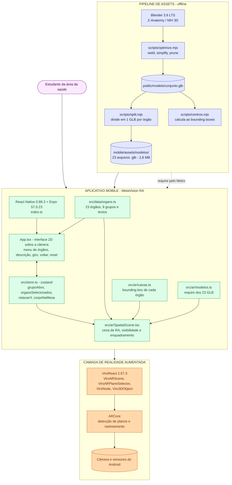
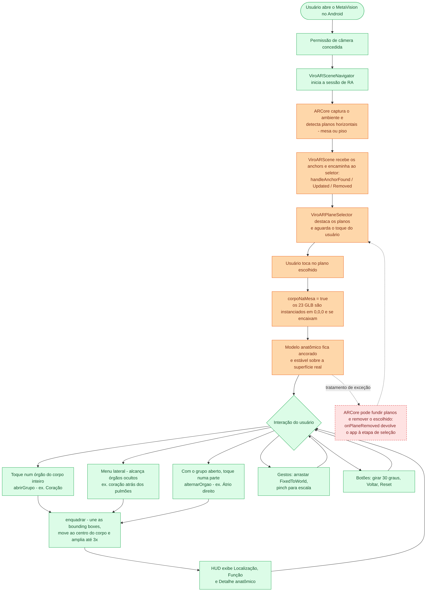
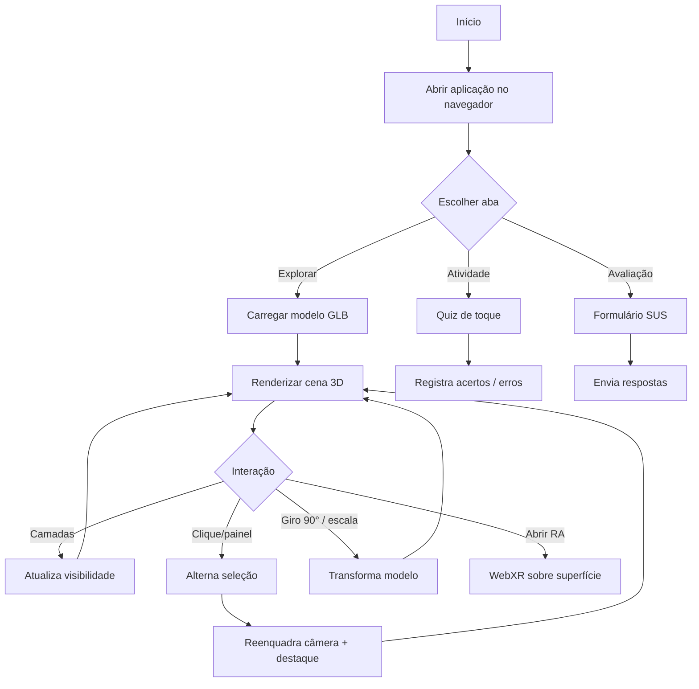
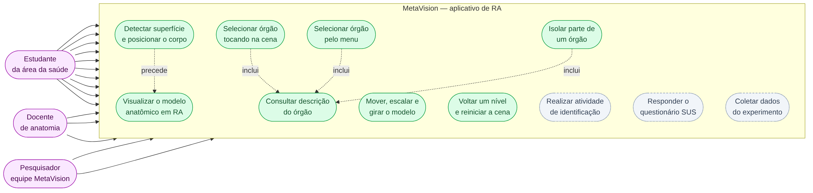

# MetaVision — Anatomia Torácica e Cervical em RA

> **Projeto UPX — Realidade Aumentada**
> Aplicação web de Realidade Aumentada com órgãos torácicos e cervicais interativos e clicáveis para apoiar a compreensão espacial da anatomia por estudantes da área da saúde.


---

## 1. Identificação do Projeto

| Item | Informação |
|---|---|
| **Projeto** | MetaVision — Anatomia Torácica e Cervical em RA |
| **Equipe** | MetaVision |
| **Curso** | A preencher |
| **Disciplina** | UPX — Realidade Aumentada |
| **Professor** | Daniel Ohata |
| **Instituição** | Facens |
| **Semestre** | 2026.2 |

### Integrantes

| Nome | RA | Responsabilidade |
|---|---|---|
| Eduarda Gomes Abreu e Almeida | 236021 | Interação |
| Carolina Leamari | 235249 | Aquisição/preparação de assets |
| Fernanda Theodoro Casali | 235329 | Documentação e pesquisa |
| Gabriel Massayuki Teixeira Ogino | 236044 | Interação |
| Lucas Proença Gonçalves do Santos | 235411 | Front / Visualização 3D |
| Higor Bertinotti Aranda | 235332 | Front / Visualização 3D |
| Gabriel Baldi Gomes dos Santos | 235452 | A definir |

---

## 2. Visão Geral

O **MetaVision** é uma aplicação web de Realidade Aumentada que sobrepõe modelos 3D interativos dos órgãos das regiões **torácica** e **cervical** ao ambiente real, permitindo ao estudante girar, aproximar e tocar cada órgão para acessar explicações individualizadas.

Órgãos cobertos no escopo do projeto: **esôfago, estômago, coração, pulmões, traqueia, laringe, faringe e tireoide**.

A proposta se alinha ao **ODS 4 — Educação de Qualidade** e, indiretamente, ao **ODS 3 — Saúde e Bem-Estar**, ao oferecer um recurso didático complementar para o ensino de anatomia.

<!-- IMAGEM: visão geral do projeto -->


---

## 3. Problema

Estudantes da área da saúde têm dificuldade em compreender a disposição espacial e as relações entre os órgãos do tórax e do pescoço quando o estudo depende apenas de representações bidimensionais de livros e atlas impressos. A imagem estática não transmite profundidade nem permite manipular o modelo.

O MetaVision propõe o uso de Realidade Aumentada e visualização 3D interativa como ferramenta de apoio ao ensino, permitindo que o estudante manipule o modelo anatômico em tempo real, isole estruturas específicas e compreenda a disposição espacial dos órgãos.

---

## 4. Objetivos

### 4.1 Objetivo Geral

Desenvolver uma aplicação web de Realidade Aumentada que ofereça manipulação espacial e conteúdo contextual de órgãos torácicos e cervicais, com modelos 3D interativos exibidos sobre o ambiente real, apoiando o ensino de anatomia para estudantes da área da saúde.

### 4.2 Objetivos Técnicos

- Configurar um projeto React com suporte a renderização 3D via React Three Fiber.
- Carregar e renderizar modelos anatômicos em formato GLB otimizado para a web.
- Nomear os meshes do modelo seguindo a convenção definida pela equipe.
- Permitir alternar a visibilidade das camadas anatômicas (visível, transparente e oculto por órgão).
- Permitir seleção individual ou agrupada de órgãos, com reenquadramento automático de câmera.
- Permitir seleção direta no modelo 3D por clique/toque.
- Oferecer giro em passos de 90° e controle de tamanho do modelo.
- Habilitar a experiência de RA no navegador via WebXR / model-viewer.
- Estruturar a aplicação em três abas: Explorar, Atividade e Avaliação.
- Aplicar instrumento de usabilidade **SUS (System Usability Scale)** para avaliação com usuários.
- Executar a aplicação em navegador moderno em desktop e dispositivos móveis.
- Documentar instalação, execução, testes e limitações.

---

## 5. Público-Alvo

- Estudantes de **medicina, enfermagem, fisioterapia, biomedicina** e cursos afins em fase de aprendizado de anatomia;
- **Docentes de anatomia**, como recurso didático complementar;
- Demais interessados em visualização anatômica 3D.

Materiais complementares de público-alvo, persona e jornada podem ser armazenados em `docs/documents/`.

---

## 6. Funcionalidades

| ID | Funcionalidade | Descrição | Status |
|---|---|---|---|
| RF01 | Carregar modelo 3D | Carrega o GLB anatômico otimizado em cena | ✅ |
| RF02 | Alternar camadas | Liga/desliga pele, caixa torácica, órgãos e vasos | ✅ |
| RF03 | Selecionar órgão | Isola um órgão individual e reenquadra a câmera | ✅ |
| RF04 | Selecionar grupo | Isola um grupo inteiro (ex: coração completo) | ✅ |
| RF05 | Clicar no 3D | Adiciona/remove um mesh da seleção por clique | ✅ |
| RF06 | Reenquadrar câmera | Ajusta a câmera à bounding box da seleção | ✅ |
| RF07 | Limpar seleção | Volta à cena completa | ✅ |
| RF08 | Camada por órgão (visível/transparente/oculto) | Cada órgão alterna entre três estados | 🚧 |
| RF09 | Giro 90° em passos | Rotaciona o modelo em incrementos de 90° | 🚧 |
| RF10 | Controle de tamanho | Permite escalar o modelo | 🚧 |
| RF11 | Órgão em destaque flutuante | Cópia ampliada do órgão selecionado acima do tronco | 🚧 |
| RF12 | Animação de câmera | Suaviza a transição com lerp / react-spring/three | 🚧 |
| RF13 | Centralização ao clicar | Órgão clicado vai ao centro da tela | 🚧 |
| RF14 | Botão "voltar" | Reseta a seleção e volta à visão geral | 🚧 |
| RF15 | Aba Explorar | Visualização 3D + painel + abertura de RA | 🚧 |
| RF16 | Aba Atividade | Quiz de toque com registro de acertos/erros | ⬜ |
| RF17 | Aba Avaliação | Formulário SUS integrado | ⬜ |
| RF18 | Experiência RA no navegador | Visualização sobre superfície via WebXR | 🚧 |
| RF19 | Painel de informações | Nome, função e localização por órgão | ⬜ |

**Legenda:** ✅ Implementado · 🚧 Em desenvolvimento · ⬜ Planejado · ❌ Cancelado

---

## 7. Requisitos Não Funcionais

| ID | Categoria | Requisito |
|---|---|---|
| RNF01 | Compatibilidade | A aplicação deverá executar em navegadores modernos com suporte a WebGL 2 |
| RNF02 | Desempenho | A cena 3D deverá manter taxa de quadros adequada à interação em desktop e mobile |
| RNF03 | Usabilidade | O usuário deverá conseguir identificar e isolar um órgão em poucos cliques |
| RNF04 | Hardware | O dispositivo deverá possuir GPU compatível com WebGL 2 e, para RA, suporte a WebXR |
| RNF05 | Documentação | O repositório deverá permitir que outra pessoa compreenda como configurar e executar o projeto |
| RNF06 | Modelo | O modelo GLB deverá ser otimizado para carregamento em rede |
| RNF07 | Avaliação | A aplicação deverá disponibilizar o formulário SUS na aba Avaliação |

---

## 8. Tecnologias e Ferramentas

### Desenvolvimento

| Tecnologia | Versão | Utilização |
|---|---|---|
| React | 18.3.x | Biblioteca de interface |
| TypeScript | 5.6.x | Tipagem estática |
| Vite | 5.4.x | Build e dev server |
| Three.js | 0.169.x | Renderização 3D (WebGL) |
| @react-three/fiber | 8.17.x | Integração React + Three.js |
| @react-three/drei | 9.114.x | Helpers de cena (CameraControls, useGLTF, Center) |
| zustand | 4.5.x | Gerenciamento de estado |
| @gltf-transform/cli | 4.1.x | Otimização de modelo GLB |
| meshoptimizer | — | Simplificação de geometria |
| WebXR | — | Experiência de RA no navegador |
| Blender | **3.6 LTS** | Modelagem/edição 3D (compatível com template Z-Anatomy) |
| Git | 2.x | Controle de versão |
| GitHub | — | Hospedagem e documentação |
| Vercel | — | Deploy da aplicação |

### Modelos anatômicos

- **Z-Anatomy** — template open source utilizado como base dos órgãos
- **NIH 3D** — acervo aberto do National Institutes of Health

### Ferramentas de gestão e colaboração

- **Trello** — gestão de tarefas (quadro Metavision)
- **Miro** — fluxo e wireframes do app
- **Google Drive** — backup e documentos
- **Discord** — comunicação da equipe
- **Google Forms** — coleta de respostas do SUS

---

## 9. Hardware Utilizado

| Equipamento | Modelo | Característica relevante | Utilização |
|---|---|---|---|
| Computador | A preencher | CPU / RAM / GPU com WebGL 2 | Desenvolvimento e execução |
| Smartphone | A preencher | Navegador moderno com WebGL 2 e WebXR | Testes de visualização e RA mobile |

> Preencher com os equipamentos efetivamente utilizados pela equipe nos testes.

---

## 10. Arquitetura do Sistema

A arquitetura está organizada em camadas: interface (componentes React), estado global (zustand), cena 3D (React Three Fiber + Three.js), modelo anatômico (GLB otimizado) e camada de RA (WebXR).

<!-- IMAGEM: arquitetura do sistema -->


### Fluxo resumido

```text
Usuário
   ↓
Interface React (Abas Explorar / Atividade / Avaliação)
   ↓
Estado global (zustand)
   ↓
Cena 3D (React Three Fiber)
   ↓
Three.js / WebGL / WebXR
   ↓
GPU + Câmera do dispositivo
   ↓
Modelo GLB renderizado sobre o ambiente real
```

---

## 11. Funcionamento da Realidade Aumentada

### 11.1 Técnica utilizada

O MetaVision combina **visualização 3D interativa em WebGL** com **experiência de RA via WebXR**, permitindo tanto a inspeção do modelo em desktop quanto a sobreposição ao ambiente real em dispositivos compatíveis.

### 11.2 Fluxo técnico

<!-- IMAGEM: fluxo técnico da aplicação -->


1. A aplicação é aberta no navegador.
2. O Vite serve os arquivos estáticos e o modelo GLB.
3. O React monta a cena Three Fiber e o painel de controles.
4. O `useGLTF` carrega o modelo `conjunto.glb` e nomeia os meshes.
5. O usuário alterna camadas, gira em 90°, ajusta tamanho e seleciona órgãos.
6. O estado global (zustand) reflete a seleção na cena.
7. O `CameraControls` reenquadra a câmera na bounding box da seleção, com transição animada.
8. Na aba Explorar, o usuário pode acionar a RA e posicionar o modelo sobre uma superfície real via WebXR.

### 11.3 Elementos virtuais

- modelo anatômico 3D (meshes nomeados);
- painel de camadas (pele, caixa torácica, órgãos, vasos);
- painel de estruturas agrupadas por órgão;
- painel lateral com nome, função e localização do órgão;
- destaque visual por isolamento e cópia ampliada do órgão selecionado;
- controles de giro 90° e escala;
- botão de abertura da RA.

---

## 12. Estrutura do Projeto

```text
metavision/
│
├── public/
│   └── models/
│       └── conjunto.glb        # modelo anatômico otimizado
│
├── scripts/
│   └── optimize.mjs            # pipeline de otimização GLB
│
├── src/
│   ├── components/
│   │   └── Controls.tsx        # painel de camadas e estruturas
│   ├── data/
│   │   └── organs.ts           # registro de camadas e órgãos
│   ├── scene/
│   │   ├── Scene.tsx           # canvas, luzes, câmera, rig
│   │   └── Model.tsx           # carregamento do GLB e interação
│   ├── App.tsx
│   ├── main.tsx
│   ├── index.css
│   └── store.ts                # estado global (zustand)
│
├── docs/
│   ├── diagrams/               # diagramas técnicos
│   ├── documents/              # documentos complementares
│   └── images/                 # screenshots e figuras
│
├── index.html
├── package.json
├── tsconfig.json
├── vite.config.ts
└── README.md
```

### Pastas principais

| Pasta | Finalidade |
|---|---|
| `src/components` | Componentes de UI React |
| `src/scene` | Componentes de cena 3D (Canvas, modelo, câmera) |
| `src/data` | Registro de camadas e meshes do modelo |
| `public/models` | Modelos GLB servidos estaticamente |
| `scripts` | Scripts auxiliares (otimização GLB) |
| `docs/diagrams` | Diagramas técnicos |
| `docs/images` | Screenshots e figuras |
| `docs/documents` | Documentos complementares |

---

## 13. Principais Scripts

| Arquivo | Responsabilidade |
|---|---|
| `src/scene/Scene.tsx` | Monta o Canvas, luzes, câmera e o rig de reenquadramento |
| `src/scene/Model.tsx` | Carrega o GLB, aplica visibilidade por camada e trata o clique |
| `src/components/Controls.tsx` | Painel de camadas e seleção de estruturas |
| `src/store.ts` | Estado global (camadas visíveis, órgãos selecionados) |
| `src/data/organs.ts` | Registro central de camadas e meshes |
| `scripts/optimize.mjs` | Otimização do GLB (weld, simplify, prune) |

---

## 14. Dependências

Principais dependências do projeto (ver `package.json` para o conjunto completo):

```text
react                 ^18.3.1
react-dom             ^18.3.1
three                 ^0.169.0
@react-three/fiber    ^8.17.10
@react-three/drei     ^9.114.0
zustand               ^4.5.5
```

Desenvolvimento:

```text
typescript            ^5.6.2
vite                  ^5.4.8
@vitejs/plugin-react  ^4.3.2
@gltf-transform/cli   ^4.1.0
playwright            ^1.64.0
```

---

## 15. Configuração do Ambiente

### Pré-requisitos

- Node.js 18 ou superior;
- npm (acompanha o Node);
- Git;
- navegador moderno com suporte a WebGL 2 (Chrome, Firefox, Edge ou Safari recentes);
- dispositivo com suporte a WebXR para testar a RA;
- **Blender 3.6 LTS** (opcional, apenas para edição do modelo — a versão 4.x apresenta incompatibilidade com o template Z-Anatomy).

### Procedimento

1. Instale o Node.js 18+ e verifique com `node -v`.
2. Instale o Git.
3. Clone o repositório.
4. Na pasta do projeto, execute `npm install`.
5. Garanta que o modelo `public/models/conjunto.glb` está presente.
6. Execute `npm run dev`.
7. Abra o endereço indicado pelo Vite no navegador.

---

## 16. Como Executar

```bash
git clone https://github.com/1Lucasi/metavision.git
cd metavision
npm install
npm run dev
```

A aplicação será servida em `http://localhost:3016`.

Para gerar a build de produção:

```bash
npm run build
npm run preview
```

Para otimizar um GLB bruto exportado do Blender:

```bash
node scripts/optimize.mjs public/models/bruto.glb public/models/conjunto.glb
```

### Deploy

O deploy da aplicação é feito na **Vercel**, a partir da branch principal do repositório.

---

## 17. Como Utilizar a Aplicação

A aplicação é organizada em três abas, seguindo o fluxo do experimento:

### Aba **Explorar**
1. Aguarde o carregamento do modelo anatômico.
2. Utilize o painel **Camadas** para alternar entre visível, transparente e oculto.
3. Em **Estruturas**, selecione um órgão individual ou um grupo (ex: Coração) para isolar.
4. Clique diretamente em um mesh na cena 3D para adicioná-lo/removê-lo da seleção.
5. Use os controles para girar em passos de 90° e ajustar o tamanho do modelo.
6. Toque no botão de RA para posicionar o modelo sobre uma superfície real.
7. Consulte o painel lateral para ver nome, função e localização do órgão.

### Aba **Atividade**
Realize o quiz de identificação: toque na parte do corpo pedida, com registro automático de acertos, erros e tempo.

### Aba **Avaliação**
Preencha o formulário SUS (System Usability Scale) para avaliar a usabilidade da aplicação.

<!-- IMAGEM: tela principal da aplicação -->


---

## 18. Fluxo de Funcionamento



---

## 19. Caso de Uso

<!-- IMAGEM: diagrama de caso de uso -->


Atores: estudante / docente.
Casos de uso principais:
- visualizar e isolar estruturas anatômicas torácicas e cervicais em 3D;
- posicionar o modelo sobre uma superfície real via RA;
- realizar atividade de identificação de órgãos;
- avaliar a usabilidade da aplicação (SUS).

---

## 20. Fluxo de Navegação

```text
Tela Inicial
    ↓
┌─── Explorar ────────────────┐
│  Cena 3D + Painéis          │
│  Camadas / Giro / Tamanho   │
│  Seleção de Órgão           │
│  Painel de Informações      │
│  Abrir RA (WebXR)           │
└─────────────────────────────┘
    ↓
┌─── Atividade ───────────────┐
│  Quiz de toque              │
│  Registro de acertos        │
└─────────────────────────────┘
    ↓
┌─── Avaliação ───────────────┐
│  Formulário SUS             │
└─────────────────────────────┘
```

---

## 21. Interface

Screenshots reais do projeto devem ser armazenados em `docs/images/`.

Exemplo de organização:

```text
docs/images/
├── tela-inicial.png
├── aba-explorar.png
├── isolamento-coracao.png
├── aba-atividade.png
├── aba-avaliacao.png
└── experiencia-ra.png
```

<!-- IMAGEM: screenshots da interface -->


---

## 22. Testes Técnicos

| Teste | Procedimento | Resultado esperado | Resultado obtido | Status |
|---|---|---|---|---|
| Build | `npm run build` | Build concluída sem erros | A preencher | 🚧 |
| Dev server | `npm run dev` | Servidor sobe em `localhost:3016` | A preencher | 🚧 |
| Carregamento do GLB | Abrir no navegador | Modelo renderiza na cena | A preencher | 🚧 |
| Alternância de camadas | Clicar nos checkboxes | Camada aparece/some | A preencher | 🚧 |
| Isolamento de órgão | Marcar um órgão no painel | Só o órgão permanece visível | A preencher | 🚧 |
| Seleção por clique | Clicar em um mesh na cena | Órgão entra na seleção | A preencher | 🚧 |
| Reenquadramento | Isolar um órgão | Câmera foca na bounding box | A preencher | 🚧 |
| Giro 90° | Acionar controle de rotação | Modelo gira em passos | A preencher | 🚧 |
| RA no navegador | Acionar botão de RA | Modelo é posicionado sobre superfície | A preencher | 🚧 |
| Quiz de toque | Executar atividade | Acertos/erros são registrados | A preencher | 🚧 |

### Avaliação com usuários — SUS

A avaliação de usabilidade é feita por meio da **System Usability Scale (SUS)**: 10 afirmações em escala Likert de 1 a 5, aplicadas via Google Forms após o uso da aplicação. O instrumento avalia apenas a usabilidade do sistema (não a aprendizagem).

---

## 23. Dispositivos Testados

| Dispositivo | Sistema | Navegador | Suporte WebXR | Resultado |
|---|---|---|---|---|
| A preencher | A preencher | A preencher | A preencher | A preencher |

---

## 24. Limitações Conhecidas

- a experiência de RA via WebXR depende de dispositivo e navegador compatíveis;
- o modelo depende de meshes nomeados conforme a convenção em `src/data/organs.ts`;
- camadas de pele e vasos ainda não estão presentes no GLB atual;
- o desempenho pode variar em dispositivos sem WebGL 2 ou com GPU limitada;
- o raycaster do Three.js intersecta meshes mesmo invisíveis — tratado no código, mas requer atenção em novos componentes;
- o template Z-Anatomy é incompatível com Blender 4.x; usar 3.6 LTS.

---

## 25. Evidências de Funcionamento

A equipe deverá incluir:

- captura(s) de tela de cada aba (Explorar, Atividade, Avaliação);
- vídeo curto demonstrando a interação com o modelo e a experiência de RA;
- link para vídeo pitch publicado.

Exemplo:

```markdown
[Assistir demonstração](COLE_AQUI_O_LINK_DO_VIDEO)
```

---

## 26. Repositórios e Recursos

| Recurso | Link |
|---|---|
| Código-fonte | https://github.com/1Lucasi/metavision |
| Modelo de repositório (disciplina) | https://github.com/dr-ohata/upx-modelo |
| Referência de interação | https://github.com/ashemag/human-atlas |
| Modelos anatômicos (NIH 3D) | https://3d.nih.gov |
| Template Z-Anatomy | https://z-anatomy.com |
| Deploy (Vercel) | A preencher |
| Miro (fluxo do app) | A preencher |
| Trello (gestão) | https://trello.com/b/bcPnYlUg/metavision |
| Vídeo pitch | A preencher |
| Formulário SUS (Google Forms) | A preencher |

---

## 27. Cronograma Técnico

| Atividade | Responsável | Status |
|---|---|---|
| Revisão bibliográfica (ensino de anatomia, dificuldade espacial) | Fernanda | 🚧 |
| Levantamento de requisitos | Fernanda, Baldi | ✅ |
| Configuração do projeto (Vite + React) | Lucas, Higor | ✅ |
| Integração React Three Fiber | Lucas, Higor | ✅ |
| Pipeline de otimização GLB | Lucas, Higor | ✅ |
| Convenção de meshes e camadas | Eduarda, Gabriel Ogino | ✅ |
| Exportação dos órgãos no Blender | Carol | ✅ |
| Conversão para .glb/gltf | Carol | ✅ |
| Painel de camadas e estruturas | Lucas, Higor | ✅ |
| Isolamento visual do órgão selecionado | Eduarda | ✅ |
| Isolamento e reenquadramento múltiplo | Lucas, Higor | ✅ |
| Camadas por órgão (visível/transparente/oculto) | Carol | 🚧 |
| Giro 90° e controle de tamanho | Carol | 🚧 |
| Órgão em destaque flutuante | Gabriel Ogino, Eduarda | ⬜ |
| Animação de transição de câmera | Gabriel Ogino | ⬜ |
| Centralização do órgão no clique | Eduarda, Lucas | ⬜ |
| Botão "voltar" (reset) | Eduarda | 🚧 |
| Habilitar interação por toque (Camera Controls) | Baldi | 🚧 |
| Validar renderização e botão de RA no navegador | Baldi | 🚧 |
| Abas Explorar, Atividade e Avaliação | Carol | 🚧 |
| Formulário SUS (Google Forms) | Carol | ✅ |
| Documentação GitHub | Fernanda, Carol | 🚧 |
| Artigo científico (AC1 / AC2) | Fernanda, Gabriel Ogino | ✅ |
| Vídeo pitch II | Fernanda, Gabriel Ogino | 🚧 |
| Polish e deploy (Vercel) | Lucas, Higor | 🚧 |

---

## 28. Controle de Versão

Exemplos de mensagens de commit utilizadas no projeto:

```text
feat: adiciona isolamento múltiplo de órgãos
feat: carrega modelo conjunto.glb com meshes nomeados
fix: evita clique em mesh invisível pelo raycaster
docs: padroniza README conforme modelo da disciplina
chore: otimiza GLB com weld e simplify
```

A equipe deverá evitar concentrar todo o desenvolvimento em um único commit.

---

## 29. Problemas Encontrados e Soluções

### Problema 1 — Lobo exportado em múltiplas primitivas

**Problema:** meshes com mais de um slot de material no Blender eram exportados como `Group` contendo sub-meshes com sufixos (`_1`, `_2`), quebrando a comparação direta por nome.
**Causa:** o GLTFLoader divide meshes multi-material em várias primitivas.
**Solução:** função `findOrganId` em `src/scene/Model.tsx` que sobe pela hierarquia até encontrar um ancestral com id conhecido.

### Problema 2 — Clique atingindo meshes invisíveis

**Problema:** o raycaster do Three.js intersecta meshes mesmo com `visible=false`, trocando a seleção para um órgão escondido ao girar próximo.
**Causa:** comportamento padrão do raycaster.
**Solução:** verificação explícita de `e.object.visible` antes de alternar a seleção.

### Problema 3 — Enquadramento incorreto após seleção múltipla

**Problema:** ao selecionar múltiplos meshes, a câmera não enquadrava o conjunto completo.
**Causa:** a bounding box precisa unir todos os meshes selecionados antes do `fitToBox`.
**Solução:** `Box3.expandByObject` percorrendo a cena e somando as caixas dos meshes marcados.

### Problema 4 — Incompatibilidade do Blender 4.x com Z-Anatomy

**Problema:** o template Z-Anatomy apresenta falhas de importação/exportação em versões recentes do Blender.
**Causa:** mudanças no addon de glTF entre 3.x e 4.x.
**Solução:** padronizar o uso do **Blender 3.6 LTS** para toda a equipe.

---

## 30. Melhorias Futuras

- concluir cobertura dos órgãos cervicais (traqueia, laringe, faringe, tireoide);
- adicionar camadas de pele e vasos ao modelo;
- expandir o quiz da aba Atividade com múltiplos níveis de dificuldade;
- adicionar painel de informações anatômicas por órgão (nome, função, localização);
- suportar múltiplas regiões anatômicas (abdome, cabeça);
- adicionar modo de corte transversal;
- melhorar a performance em dispositivos móveis;
- registrar métricas de uso agregadas (acertos, tempo de interação);
- publicar o relatório final de usabilidade a partir das respostas do SUS.

---

## 31. Custos e Recursos

| Recurso | Tipo | Custo/Condição |
|---|---|---|
| Node.js | Software | Gratuito |
| React / Three.js / Vite | Software | Gratuito (código aberto) |
| Blender 3.6 LTS | Software | Gratuito |
| GitHub | Serviço | Gratuito para o uso acadêmico |
| Vercel | Serviço | Plano gratuito |
| Google Forms (SUS) | Serviço | Gratuito |
| Miro / Trello / Discord | Serviço | Plano gratuito |
| Modelos Z-Anatomy / NIH 3D | Assets | Acervo aberto |
| Computador | Hardware | Equipamento da equipe |
| Smartphone | Hardware | Equipamento da equipe |

O custo total do projeto tende a zero; o principal "investimento" é hora-trabalho.

---

## 32. Licença

Projeto acadêmico desenvolvido para fins educacionais na disciplina de UPX — Realidade Aumentada da Facens.

Caso a equipe adote uma licença formal de software, substituir este texto e incluir o arquivo `LICENSE` correspondente.

---

## 33. Autores

- **Eduarda Gomes Abreu e Almeida** — Interação
- **Carolina Leamari** — Aquisição e preparação de assets
- **Fernanda Theodoro Casali** — Documentação e pesquisa
- **Gabriel Massayuki Teixeira Ogino** — Interação
- **Lucas Proença Gonçalves do Santos** — Front / Visualização 3D
- **Higor Bertinotti Aranda** — Front / Visualização 3D
- **Gabriel Baldi Gomes dos Santos** — A definir

**Orientação:** Prof. Daniel Ohata — Gerente de Projeto
**Instituição:** Facens
**Disciplina:** UPX — Realidade Aumentada
**Semestre:** 2026.2

---

## Checklist de Entrega

- [x] Código-fonte atualizado
- [x] Equipe identificada
- [x] Versões das tecnologias registradas
- [x] Arquitetura apresentada
- [x] Funcionamento da RA explicado
- [x] Estrutura de pastas documentada
- [x] Scripts principais descritos
- [x] Procedimento de instalação testado
- [x] Procedimento de execução testado
- [x] ODS do projeto declarados
- [x] Instrumento de avaliação definido (SUS)
- [x] Limitações conhecidas documentadas
- [x] Commits representam a evolução do projeto
- [ ] Screenshots reais adicionados
- [ ] Testes técnicos registrados
- [ ] Dispositivos testados informados
- [ ] Evidência de funcionamento (vídeo) adicionada
- [ ] Deploy publicado na Vercel

---

> Este README segue o modelo de documentação proposto pelo professor Daniel Ohata para a disciplina de UPX — Realidade Aumentada (Facens).

